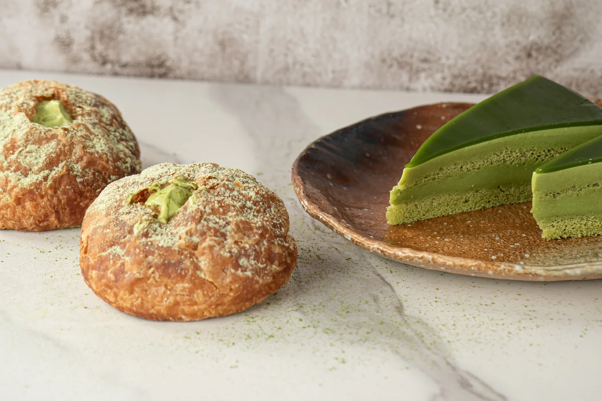

# Japonaise Bakery & Cafe — Redesigned Website

A fast, responsive, and modern website redesign for **Japonaise Bakery & Cafe** (Brookline, MA), built with React 19, Vite, and Tailwind CSS. Hosted on GitHub Pages at $0/month.



## 🥐 About the Bakery
Established in 1985 in Greater Boston by Hiroko Sakan, Japonaise Bakery is renowned for handcrafted French pastries with an authentic Japanese twist—featuring fluffy **Shoku Pan** (milk bread), award-winning croissants, **Matcha Azuki** laminations, seasonal celebration cakes, and savory onigiri.

- **Location:** 1020 Beacon Street, Brookline, MA 02446 (Directly opposite MBTA Green Line C St. Mary's Stop, next to Whole Foods)
- **Phone:** (617) 566-7730
- **Email:** japonaise617@gmail.com
- **Hours:** Thursday – Sunday: 8:00 AM – 8:00 PM (Monday – Wednesday: Closed for scratch baking prep)

---

## ✨ Features Included in This Redesign
1. **100% Complete Menu Coverage:**
   - Traditional Bread (Shoku Pan, Premium Milk Loaf, Butter Rolls, Challahs, Baguettes)
   - Sweet Bread (An Pan, Melon Pan, Custard Cream, Totoro Pan, Boston Cream, Chocolate Horn)
   - Fried Bread & Donuts (Curry Pan, An Doughnut, Kinako Twists, Cinnamon)
   - Croissants & Pastries (Award-winning Butter Croissant, Azuki Cream, Matcha Azuki, Ichigo Cream, Almond Croissant)
   - Cakes (Strawberry Shortcake, Japonaise Green Tea Cake, Choco Queen, Bread Puddings)
   - Savory Sandwiches (Chicken Katsu, Croquette) & Handmade Onigiri (Spicy Tuna, Ume, Konbu, Takana)
2. **Interactive Search & Dietary Filters:** Real-time search across all pastries, gluten-free tags, bestsellers filter, and photo lightbox modals.
3. **Dynamic Real-Time Hours Status:** Live badge showing whether the bakery is currently open or when it next opens based on Boston time (America/New_York).
4. **Heritage Timeline:** Interactive 1985–Present history with archival photographs and newspaper clippings.
5. **Seasonal Specials:** Holiday cakes (Christmas, Mother's Day, Valentine's, Thanksgiving) and Studio Ghibli character breads (No Face & Kodama).
6. **Bilingual Careers Section:** Job openings with English and Japanese (日本語) descriptions, requirements, and an instant application modal.
7. **Directions & Transit Guide:** Embedded Google Map with MBTA Green Line directions and parking information.
8. **Automated GitHub Pages Deployment:** Built with GitHub Actions (`.github/workflows/deploy.yml`) for seamless updates on git push.

---

## 🚀 Development & Build

```bash
# Install dependencies
npm install

# Run local development server
npm run dev

# Build for production
npm run build

# Preview production build locally
npm run preview
```
